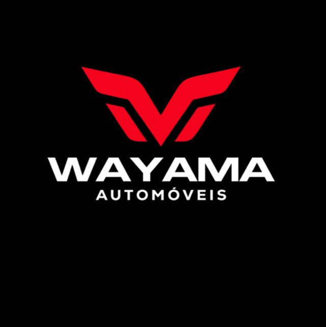

<div align="center">

# Repositório Oficina


### Backend & Database Developer in evolution · Cybersecurity Exploring



**WAYAMA AUTOMÓVEIS**

<br>

🚗

</div>

---

## Descrição

Oficina Automóvel
```text
Manutenção
   ↓
Diagnóstico
   ↓
Cybersecurity
```

TÍTULO PRICIPAL **Cuidamos do seu carro para que você não pare**.


> TEXTO **Na WAYAMA Auto prestamos serviços de manutenção, diagnóstico e reparação automóvel, com foco na qualidade, segurança e confiança.**

---

## Funcionalidades

<table>
<tr>
<td width="100%">

* Falar pelo WhatsApp 
* Ligar para a Oficina
* Como chegar a oficina

</td>
</tr>
</table>

---

## 🛠️ Nossos serviços


<table>
<tr>
<td width="25%">

### Manutenção preventiva

* Troca de óleo e filtros
* Troca de pastilhas e discos
* Revisão de suspensão
* Verificação de fluidos
* Revisão geral do veículo
* Manutenção do sistema de arrefecimento

</td>

<td width="25%">

### Manutenção corretiva

* Identificação e correção de avarias
* Reparação de componentes
* Substituição de peças
* Correção de falhas mecânicas
* Reparação de sistemas elétricos

</td>
</tr>

<tr>
<td width="25%">

### Diagnóstico automóvel

* Diagnóstico computadorizado
* Leitura e eliminação de códigos de avaria
* Diagnóstico de problemas eletrónicos
* Verificação de sensores
* Diagnóstico de motor e transmissão
</td>

<td width="25%">

### Reparação de motor

* Diagnóstico de falhas do motor
* Reparação de componentes
* Junta da cabeça
* Sistema de distribuição
* Revisão e reparação do motor
</td>

<td width="25%">

### Reparação de caixa de velocidade

* Diagnóstico da caixa
* Reparação da caixa manual
* Reparação da caixa automática
* Troca de óleo e transmissão 
* Verificação de embriagem
* Diagnóstico de problemas de transmissão
</td>

### Sistema eléctrico

* Diagnóstico eléctrico
* Bateria e sistema de carregamento
* Alternador
* Alternador
* Motor de arranque
* Iluminação
* Sensores e componentes elétricos
</td>

### Ar condicionado

* Diagnóstico do sistema
* Recarga de gás
* Verificação de fugas
* Manutenção do compressor 
* Limpeza e manutenção do sistema
</td>

### Travões, suspensão e direção

* Pastilhas
* Discos
* Amortecedores
* Terminais de direção 
* Braços de suspensão
* Rótulas
* Alinhamento e balanceamento
</td>
</tr>
</table>


# No site também poderá ter uma secção verificar check-up, onde terá ckeckbox que serão marcadas a cada check-up feito no veículo.

### Checkbox

**Botão agendar check-up pelo WhatsApp**
---

### Como funcionaria

Essa é uma parte super importante.
<br>
<p>1- Contacte-nos | apontar a câmera para o QR code ou clique no botão de WhatsApp</p>
<p>2- Explicar problema | envie marca, modelo, ano e descreva a avria do automóvel</p>
<p>3- Avaliação do veículo | a nossa equipeorienta o diagnóstico e o serviço necessário
<p>4- Reparação | Após aprovação do cliente realizamos o serviço</p>
<p>Entrega | O veículo é entregue após a conclusão e verificação do serviço</P>

---

# Modelo de formulário - Solicitar uma avaliação

```text
        Nome
          ↓
       Número de telefone
          ↓
      Marca do veículo
          ↓
     Modelo do veículo
          ↓
       Ano
          ↓
       Quilometragem
          ↓
        Serviço
          ↓
        Campo para ddescrição do problema
          ↓
        Enviar fotgrafia da avaria
          ↓
        Enviar pelo WhatsApp
```

---

---

# Extras

```text
Porque escolher a Wayama auto
Sobre nós
Galeria (Fotografias de: oficina, motores, viaturas, equipamentos, etc...)
Contactos (Localização, telefone, whatsapp, e-mail, horário de atendimento)
```
